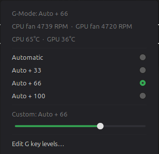

# G-Mode Fan Boost (Dell G3 3590)

Makes the **G key** and a **panel applet** control the fans on a Dell G-series laptop,
like Game Shift / Alienware Command Center does on Windows.



- **G key** steps through boost levels: `Automatic → +33 → +66 → +100 → Automatic` (your choice of levels).
- **Panel applet** shows the level, both fan speeds and CPU/GPU temperatures. Pick a level,
  drag the slider (0–100), or scroll on the icon.
- **Command line:** `g-fan-boost set 70`, `add +10`, `add -10`, `status`.

Tested on a **Dell G3 3590**, Linux Mint 22.3 (Cinnamon 6.6), kernel 7.0.

## How the fan control works

Dell's firmware has a fan **boost** that is added on top of its automatic fan curve:

```
fan speed = automatic curve (follows temperature) + boost
```

Boost `0` is the normal automatic mode. The automatic curve is cautious: on the G3 3590 at 99°C
it only ran the fans at about 3,600–4,300 RPM, while the fans can do about 5,800 RPM.

Measured on the G3 3590:

| Boost | Idle (64°C) | Full load (99°C) |
|---|---|---|
| 0 (automatic) | 2,800 RPM | 3,600 → 4,300 RPM |
| 33 | 3,800 RPM | 4,700 RPM |
| 66 | 4,800 RPM | — |
| 100 | 5,800 RPM (max) | 5,800 RPM |

The fans settle about 5 seconds after a change. After a reboot the boost starts at 0 (automatic).
The firmware also resets it to 0 whenever its thermal mode changes.

### Requirements

- A Dell G-series / Alienware laptop where the kernel's `alienware_wmi` driver exposes
  `fan1_boost` and `fan2_boost`. Check with:
  ```bash
  cat /sys/class/hwmon/hwmon*/name | grep alienware_wmi
  ls /sys/class/hwmon/hwmon*/fan*_boost
  ```
- **Kernel 6.15 or newer.** Kernel 6.14 has `alienware_wmi` but no fan boost.
  On Mint 22, the HWE kernel (`linux-generic-hwe-24.04`) is new enough.
  If `uname -r` still shows an old kernel after updating, see [GRUB Linux Mint Entry](../GRUB%20Linux%20Mint%20Entry/).
- **Boost range 0–100.** The G3 3590 firmware rejects anything above 100 with an I/O error,
  even though other Alienware models accept 0–255. The scripts clamp every value to 0–100.

## Install

```bash
cd "G-Mode Fan Boost" && ./install.sh
```

Options: `--key <name>` binds a different key, `--no-key` skips the shortcut, `--no-applet` skips the applet.

The installer:
1. Checks that `alienware_wmi` fan boost exists.
2. Installs `/usr/local/bin/g-fan-boost` (root-owned; the only thing that writes to the fans)
   and `/usr/local/bin/g-key` (what the G key runs).
3. Adds `/etc/sudoers.d/g-fan-boost` so your user can run **only** `g-fan-boost` without a password.
   The rule is checked with `visudo` before it's installed.
4. Creates `~/.config/g-mode.conf` with the default levels if it doesn't exist.
5. Adds a Cinnamon keyboard shortcut "G-Mode (fan boost)" for `XF86Launch8`.
6. Copies the applet to `~/.local/share/cinnamon/applets/g-mode@shantil` and adds it to the panel.

### The G key

On the G3 3590 the G key is F7 without Fn. It sends `KEY_F17` (scancode `0xbb`), which X11 maps to
`XF86Launch8`. On another model, find your key with:
```bash
sudo evtest      # pick the keyboard, press the key, look for KEY_...
xev -event keyboard | grep keysym
```
and install with `./install.sh --key <keysym>`.

## Choosing levels

Edit `~/.config/g-mode.conf` (no password needed). The G key and the applet's menu both use it,
and changes apply on the next press:

```bash
LEVELS="0 33 66 100"        # default
LEVELS="0 50 100"           # fewer steps
LEVELS="0 100 50"           # cycles in the order written
```

Values are cleaned up instead of rejected: `150` becomes `100`, `-3` becomes `0`, `25.4` becomes `25`,
`50%` becomes `50`, repeats are dropped, and entries with no number (like `abc`) are skipped.

## Command line

```
g-fan-boost status          boost and both fan speeds
g-fan-boost get             current boost
g-fan-boost set <value>     set boost (clamped to 0-100; "50%", decimals, " 66 " accepted)
g-fan-boost add <+/-value>  change boost relative to now (clamped to 0-100)
g-fan-boost on | off | toggle
```
Run it with `sudo` (no password needed after install). Only input with no number at all is refused.

## Applet settings

Right-click the fan icon → *Configure*:
- **Panel label:** level (`Auto`, `+66`), level and CPU fan RPM, or icon only.
- **Scroll step:** how much each scroll changes the boost (default 5).
- **Refresh interval:** how often fan speeds update (default 2 s).

If the panel shows `!`, hover over it for the error (for example, the kernel has no fan boost).

## Warning: don't use the `dell-pc` "performance" profile

On the G3 3590, kernel 6.14 and 7.0 also load a `dell-pc` platform-profile driver. Its
**performance** mode turned both fans **off** (0 RPM, silent) while the CPU was at 85–92°C.
Mint's power menu **Performance** option (power-profiles-daemon) sets every platform profile,
including that one. Stay on *Balanced* in the power menu, or stop the driver from loading:
```bash
echo "blacklist dell_pc" | sudo tee /etc/modprobe.d/no-dell-pc.conf   # then reboot
```

## Uninstall

```bash
sudo rm /usr/local/bin/g-fan-boost /usr/local/bin/g-key /etc/sudoers.d/g-fan-boost
rm -r ~/.local/share/cinnamon/applets/g-mode@shantil ~/.config/g-mode.conf
```
Then remove the applet from the panel and the "G-Mode (fan boost)" shortcut in Keyboard settings.

## How this was worked out

- The G3 3590 firmware's ACPI method `\_SB.AMW1.WMAX` (the interface Alienware Command Center uses)
  handles fan boost as method `0x15`, operation `0x02`, fan IDs `0x32` (CPU) and `0x33` (GPU),
  and only accepts values `<= 0x64` (100).
- Earlier attempts that don't work on this model: writing `pwm1` through `dell_smm_hwmon`
  (the firmware overrides it within seconds) and `alienware_wmi` thermal profiles (all writes return I/O errors).
